<p align="center">
  
</p>

<h1 align="center">Spline</h1>

<p align="center">
  <b>Lightweight font creation.</b><br>
  Draw letters with a brush or a pen, import SVG, kern your pairs<br>
  and get a ready TTF/OTF font without a long learning curve.
</p>

<p align="center">
  
  
  <a href="https://github.com/GeekFreak01/spline/releases/latest"></a>
  
  
</p>

<p align="center">
  <a href="https://github.com/GeekFreak01/spline/releases/latest"></a>
  &nbsp;
  <a href="https://spline.geekfreak.tv"></a>
</p>

<p align="center">
  <a href="README.md">Русский</a> · <b>English</b> ·
  <a href="https://github.com/GeekFreak01/spline/releases">All releases</a> ·
  <a href="examples/demo.sp">Demo project</a>
</p>

<br>

<p align="center">
  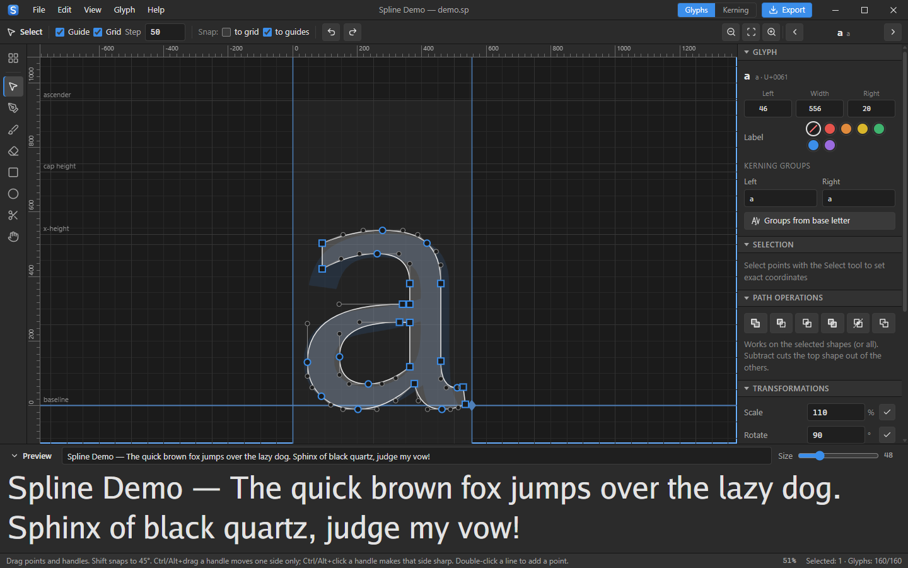
  <br>
  <sub>The outline editor: points, handles, rulers and font lines, docked panels and a live text preview.<br>
  Demo project <a href="examples/demo.sp">examples/demo.sp</a>, built from the outlines of the open Go Regular font (© The Go Authors, BSD-style license).</sub>
</p>

> [!NOTE]
> **The code was written almost entirely with the help of AI.** Ideas come from [Glyphs](https://glyphsapp.com) and [FontForge](https://github.com/fontforge/fontforge),
> but everything is kept as simple as possible: one program file, its own window without a browser, a project in one `.sp` file.

<p align="center">
  <a href="#features">Features</a> ·
  <a href="#everything-in-the-box">Everything in the box</a> ·
  <a href="#getting-started">Getting started</a> ·
  <a href="#sp-files-share-your-projects">.sp files</a> ·
  <a href="#keyboard-shortcuts">Shortcuts</a> ·
  <a href="#how-it-works">How it works</a>
</p>

<br>

<table>
  <tr>
    <td width="25%" valign="top">
      <h3>🪶 Easy to start</h3>
      Familiar menus, tools and shortcuts from Photoshop, Illustrator and Glyphs. Download, open, draw: nothing to set up, nothing long to learn.
    </td>
    <td width="25%" valign="top">
      <h3>✍️ Brush and script</h3>
      Draw with a mouse or a stylus and the stroke becomes curves. Alternates and ligatures for handwriting fonts and their connections.
    </td>
    <td width="25%" valign="top">
      <h3>🔤 Kerning like Glyphs</h3>
      Pairs and groups, exceptions, groups found by letter shape and suggested values. You see who every rule affects.
    </td>
    <td width="25%" valign="top">
      <h3>📦 One file</h3>
      The program is a single Go executable that works offline. A project is a text <code>.sp</code> file, easy to send in a messenger.
    </td>
  </tr>
</table>

<br>

## Features

<table>
  <tr>
    <td width="50%" valign="top">
      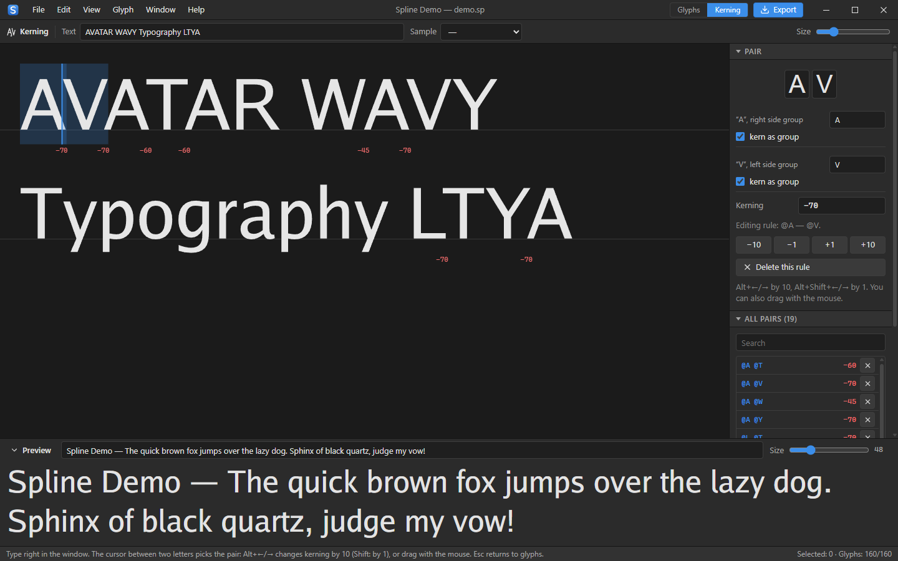
      <br>
      <sub>The kerning line: blue bars are pairs moved closer; on the right, whole group or this letter only.</sub>
      <h3>Kerning you can see</h3>
      Type text right in the window, the cursor between two letters picks the pair. <code>Alt+←/→</code> changes the value, or drag with the mouse. Bars between letters show the kerning: blue is tighter, yellow looser, red too tight.
      <br><br>
      Under each letter of the pair you see <b>who the value affects</b>: the whole group (with its letters) or this letter only. A list of all pairs with sorting, filters, Clean up and Compress. The font gets <code>GPOS</code> and <code>kern</code> tables.
    </td>
    <td width="50%" valign="top">
      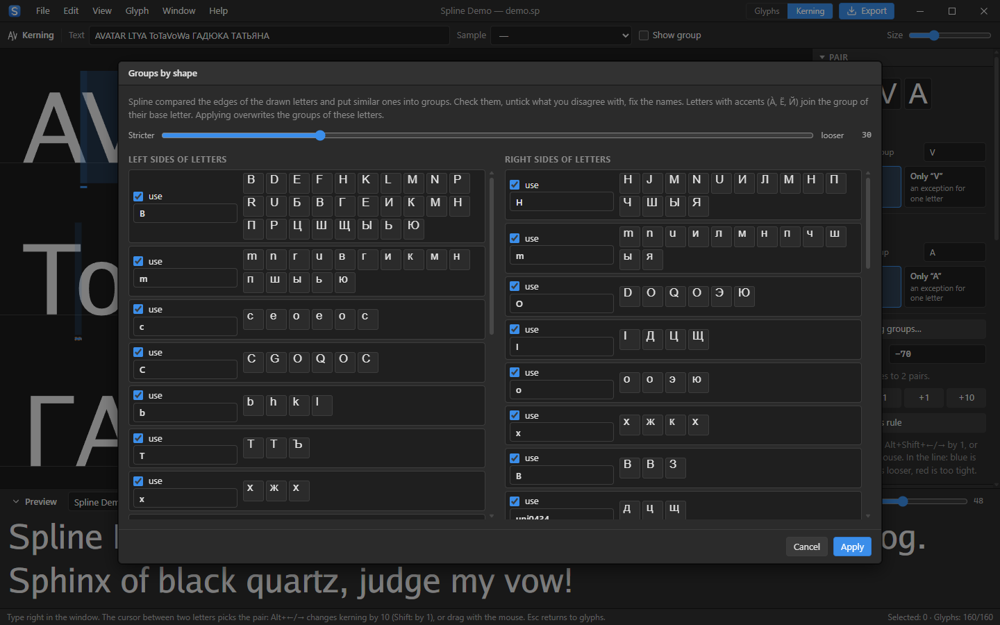
      <br>
      <sub>Find groups by shape: Spline compared the edges of the letters and put similar ones together.</sub>
      <h3>Groups without the chores</h3>
      Kerning groups as in Glyphs: every letter has a left and a right side group, and one rule <code>@A — @V</code> works for all of them. The Kerning groups window shows them as cards, letters move with the mouse, a group can be renamed together with its pairs.
      <br><br>
      <b>Find groups by shape</b> compares the edges of the drawn letters and proposes groups. <b>Suggest kerning</b> proposes values for the pairs of the line, and you accept or skip them.
    </td>
  </tr>
  <tr>
    <td width="50%" valign="top">
      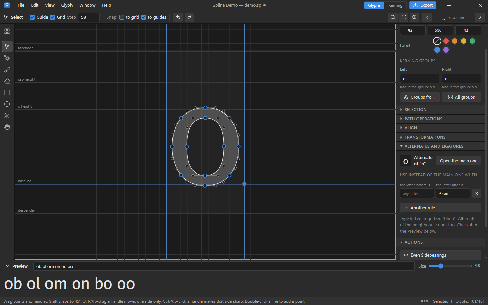
      <br>
      <sub>An alternate “o” for script: used instead of the main one before “б”, “л”, “м” or “н”.</sub>
      <h3>Alternates and ligatures for script</h3>
      An alternate is another shape of the same letter, for example an “o” with another connection. It takes its place by itself when the right letters stand before or after it. A ligature replaces several letters in a row with one shape.
      <br><br>
      The font gets the standard OpenType features <code>calt</code> and <code>liga</code>, applied right away by browsers, Word, Figma and Photoshop.
    </td>
    <td width="50%" valign="top">
      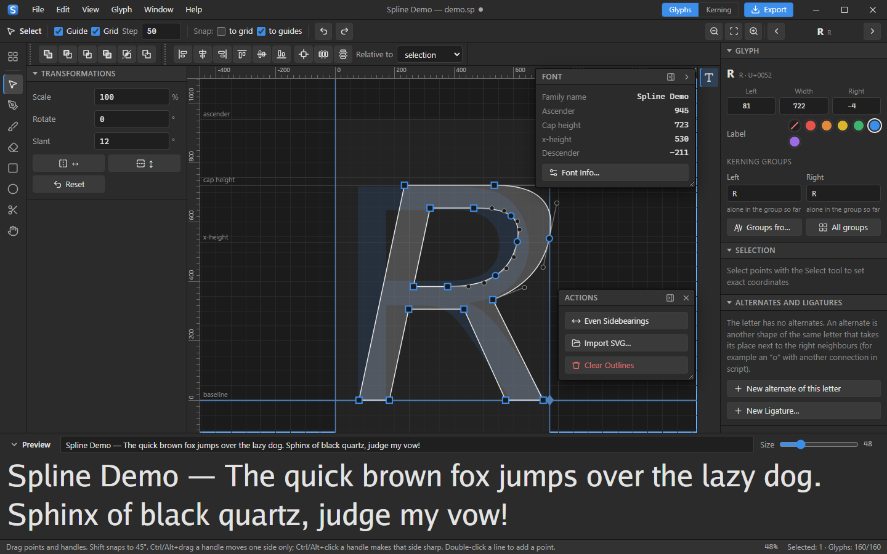
      <br>
      <sub>Panels on top, on the left, as an icon and floating.</sub>
      <h3>A workspace that fits you</h3>
      Like in Photoshop: drag a panel header and it becomes a window. Dock it on the right, on the left, into the icon strip (a click opens the panel) or on top, where Align and Path operations sit in one row.
      <br><br>
      The place it will dock to is outlined while you drag, and the layout is remembered. The <b>Window</b> menu shows and hides panels.
    </td>
  </tr>
  <tr>
    <td width="50%" valign="top">
      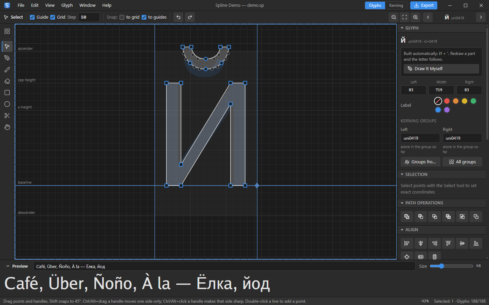
      <br>
      <sub>Й is built from И and ˘: fix И and Й follows.</sub>
      <h3>Letters with diacritics build themselves</h3>
      Draw the base letter and the mark once, and Й, Ё, À, é, ñ, ü and others are built from them. The mark is centred, raised for capitals and never touches the letter. Redraw И or ˘ and every letter made from them is updated.
      <br><br>
      Need a custom shape? Draw It Myself turns the letter into a normal one, and Build Automatically brings it back.
    </td>
    <td width="50%" valign="top">
      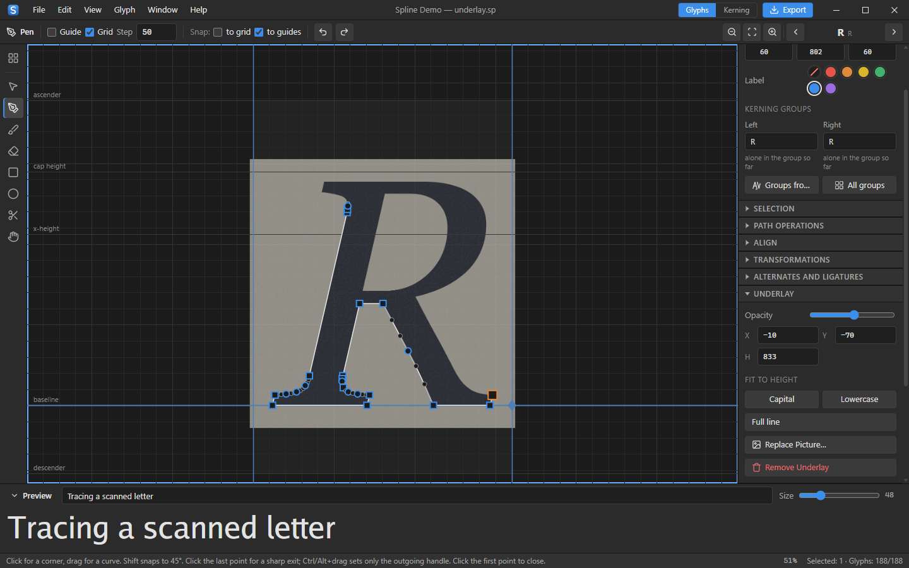
      <br>
      <sub>A scanned letter under the outline, traced with the pen.</sub>
      <h3>Underlay from a scan or photo</h3>
      Drop a picture on the canvas or on a glyph tile and it is fitted to the capital or lowercase height. Opacity, position and fitting to the font lines are in the Underlay panel. The picture is not part of the font.
      <br><br>
      After the brush or tracing, <b>Simplify Outline</b> removes extra points without changing the shape. A ready <code>.ttf</code>/<code>.otf</code> opens as a project, and Install Font in System puts it into Word and Photoshop right away.
    </td>
  </tr>
  <tr>
    <td width="50%" valign="top">
      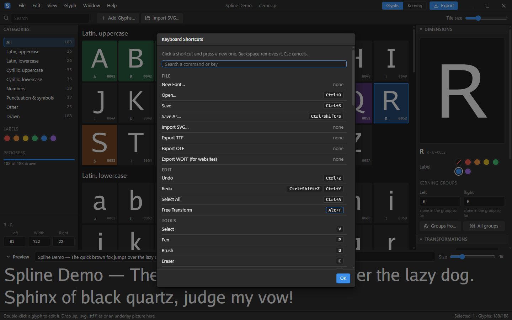
      <br>
      <sub>Keyboard shortcuts (F1): click a shortcut and press a new one.</sub>
      <h3>Shortcuts your way</h3>
      Any shortcut can be reassigned, even for commands that had none. A taken shortcut moves over, and menus and tooltips show the new keys right away.
      <br><br>
      Shortcuts work with any keyboard layout, including Russian. Modifiers like in Illustrator and Figma: <code>Shift</code> for 45°, <code>Ctrl</code>/<code>Alt</code> for a sharp corner.
    </td>
    <td width="50%" valign="top">
      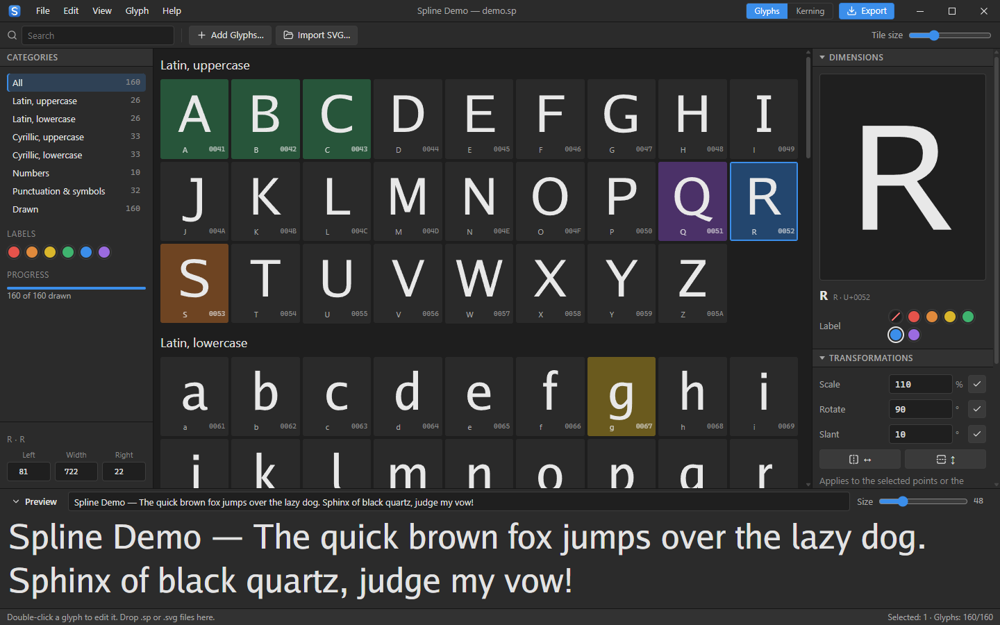
      <br>
      <sub>Every letter of the font as a tile, with categories, labels and progress.</sub>
      <h3>The whole font at a glance</h3>
      Sections by category, colour labels, Unicode codes, drawn / not drawn filters. Sidebearings and groups can be changed right on the selected letters.
      <br><br>
      The live preview below sets any text in your font, letters not drawn yet are dimmed. Export to <code>.ttf</code> and <code>.otf</code>.
    </td>
  </tr>
</table>

## Everything in the box

<table>
  <tr>
    <td width="50%" valign="top">
      <h3>🧰 Drawing</h3>
      Select · Pen (Bézier curves) · Brush with a stabilizer · Eraser · Rectangle · Ellipse · Knife · Hand · Text: edit a glyph right inside a word, the neighbours drawn grey with their widths and kerning, double-click a neighbour to edit it · free transform <code>Ctrl+T</code> (scale, rotate, move, snapping) · path operations (unite, subtract, intersect, exclude, divide, remove overlap) · align and distribute relative to the selection, a key object or the glyph frame · exact coordinates of points and shapes · Simplify Outline removes extra points after the brush · underlay: drop a scan or photo of a letter and trace it · letters with diacritics (Й, Ё, À, é…) build themselves from the base letter and the mark.
    </td>
    <td width="50%" valign="top">
      <h3>📐 Grid, rulers, transformations</h3>
      Grid with an adjustable step and snapping (<code>F9</code>) · snapping to the font lines (<code>F10</code>) · rulers and guides <code>Ctrl+R</code>, like in Photoshop · transformations with live values: scale, rotate, slant from the baseline, flip · even sidebearings in one click.
    </td>
  </tr>
  <tr>
    <td width="50%" valign="top">
      <h3>🔁 Import and export</h3>
      SVG from Illustrator, Figma, Inkscape: as a file, by drag and drop or by pasting code (<code>Ctrl+V</code>); files named <code>A.svg</code>, <code>uni0416.svg</code>, <code>Ж.svg</code> go to their glyphs · glyphs from another <code>.sp</code> · a ready <code>.ttf</code>/<code>.otf</code> or a UFO (<code>.ufoz</code>, a <code>.zip</code> with a <code>.designspace</code>) opens as a project · copying glyphs between projects · export to <code>.ttf</code> (TrueType) and <code>.otf</code> (CFF) with kerning, alternates and ligatures · a family (Glyph → Family…): bold, light and italic, styles from Thin to Black, every style exported as one <code>.zip</code>.
    </td>
    <td width="50%" valign="top">
      <h3>🪄 Comfort</h3>
      Autosave · undo and redo · a guide to every part (Help → User Guide) · its own window on Windows, no browser · dark and light themes · English and Russian · an icon and double-click for <code>.sp</code> files · font install into the system with one click · Cyrillic font names · an installer with a folder choice · a notice when a new version is out · also works as a website.
    </td>
  </tr>
</table>

## Extended mode

The simple mode stays simple. Everything for serious type work switches on in **View → Extended Mode** — the tools appear in the menus, panels and the toolbar, and every button has a label and a tooltip.

<table>
  <tr>
    <td width="50%" valign="top">
      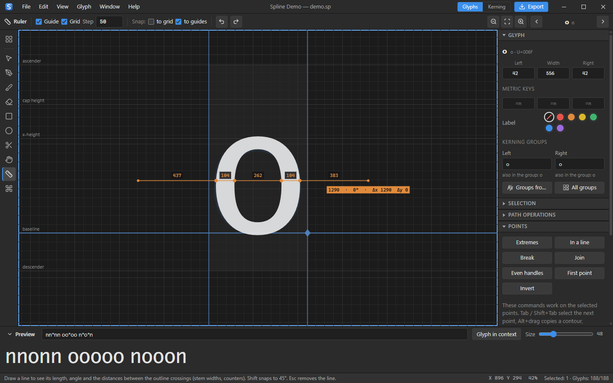
      <br>
      <sub>The Ruler measures stems and counters; the Points panel holds the editing commands.</sub>
      <h3>✏️ Editing and spacing</h3>
      Extremes, align in a line, break and join contours, even handles, first point, lasso, Tab through points, Alt-drag to copy · the Ruler tool: length, angle, stem widths · metric keys <code>=n</code>, <code>=o+10</code>, <code>=|</code> · sidebearings right in the kerning line · background and glyph snapshots · Open Corner (ears) and Reconnect back into a corner, segment deletion with <code>Alt+Delete</code>, an open end dragged onto another one joins it · alignment zones: Overshoot (zones) in Font Info, zones on the canvas, points in or near a zone are marked, OTF fonts get BlueValues.
    </td>
    <td width="50%" valign="top">
      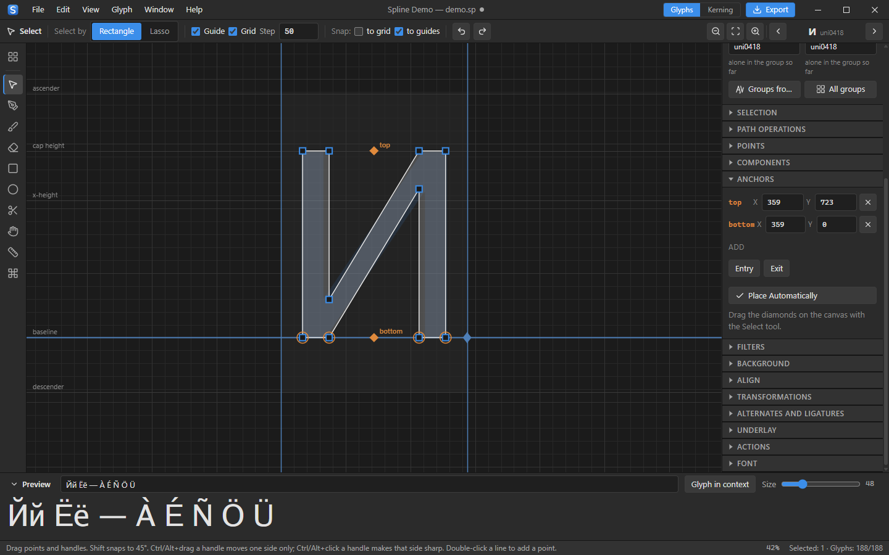
      <br>
      <sub>Top and bottom anchors: marks land on letters by them.</sub>
      <h3>🧩 Components and anchors</h3>
      A glyph inside a glyph as a live reference (À = A + `) · anchors <code>top</code>/<code>_top</code>, entry and exit for handwriting · the font gets <code>mark</code>, <code>mkmk</code>, <code>curs</code> and GDEF · adding glyphs by code and whole alphabets.
    </td>
  </tr>
  <tr>
    <td width="50%" valign="top">
      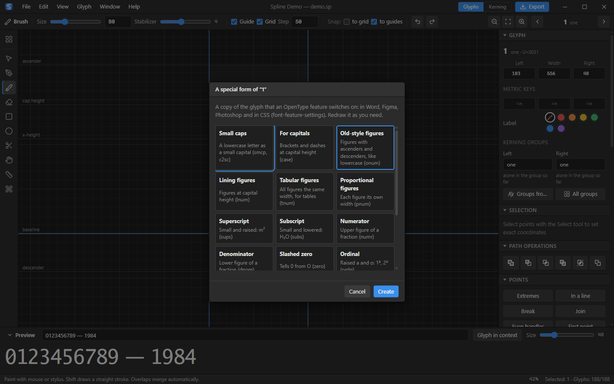
      <br>
      <sub>Special Form…: pick what the copy is for and the OpenType feature appears by itself.</sub>
      <h3>🔠 OpenType without code</h3>
      Special Form…: small caps, figure styles, superscript and subscript, slashed zero, swash, stylistic sets, Bulgarian and Serbian forms, “1/2” fractions · feature checkboxes in the preview · font info: rights, weight, slant, line gap · WOFF2 and WOFF export for websites · UFO export for Glyphs, FontLab, RoboFont and fontmake.
    </td>
    <td width="50%" valign="top">
      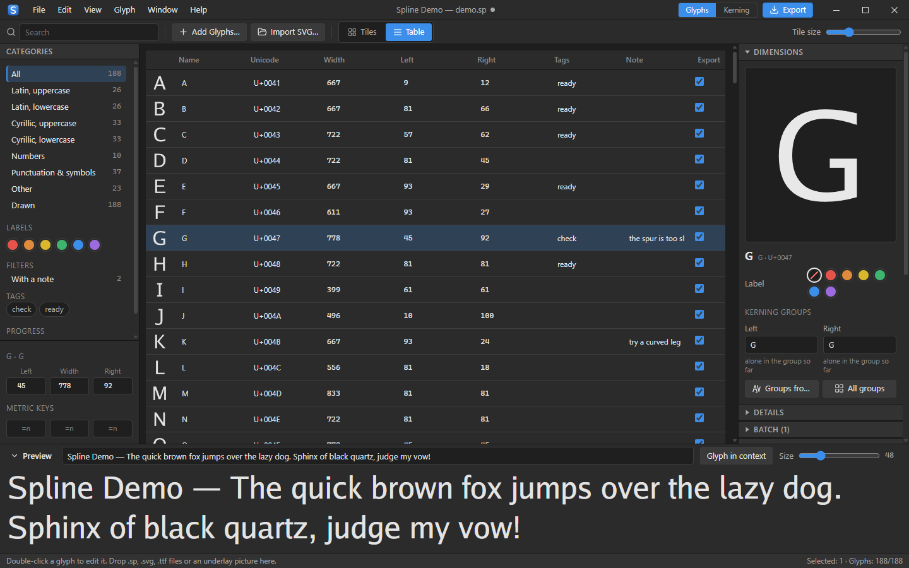
      <br>
      <sub>The table: in-place editing, tags, notes and filters.</sub>
      <h3>📋 Glyph list</h3>
      A table with in-place editing and sorting · renaming that updates kerning and rules · tags, notes, "do not export" · filters · batch commands for the selected glyphs · duplicating.
    </td>
  </tr>
  <tr>
    <td width="50%" valign="top">
      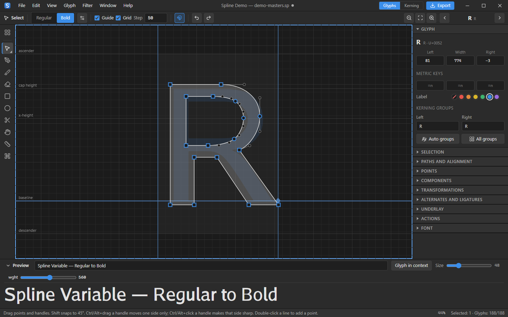
      <br>
      <sub>Regular and Bold masters, a weight slider in the preview.</sub>
      <h3>🎚️ Masters and variable fonts</h3>
      One glyph drawn in several styles on the weight and width axes · the master switch above the canvas and in kerning · kerning of its own in every master · “All masters”: the other masters' outlines over the glyph, red where a contour will not blend · “Edit all masters”: new points, deletions, cuts and ears go into every master at once · the Family window: a bold, light or italic master in one click, styles from Thin to Black with italics · family export as one .zip and install in the system · a variable font where both outlines and kerning vary: upright and italic separately · a UFO per master and a <code>.designspace</code>, italics on an <code>ital</code> axis.
    </td>
    <td width="50%" valign="top">
      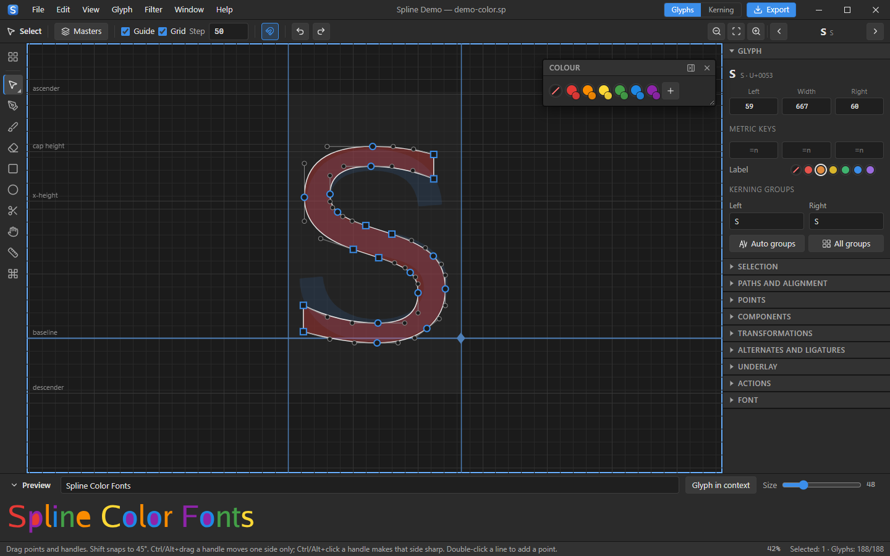
      <br>
      <sub>The palette in the Colour window: each contour in its own colour.</sub>
      <h3>🎨 Colour fonts</h3>
      A palette and a colour for each contour · the preview shows it in colour right away · the font gets COLR and CPAL, so browsers and apps show the letters in colour.
    </td>
  </tr>
  <tr>
    <td width="50%" valign="top">
      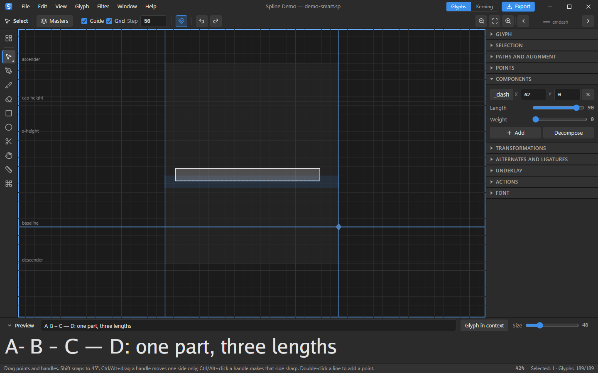
      <br>
      <sub>One smart part: hyphen, en dash and em dash are just different lengths.</sub>
      <h3>🧱 Smart parts</h3>
      A part with properties (“Length”, “Weight”…) and sliders · every glyph uses it with its own values · edit the part and every glyph that uses it follows.
    </td>
    <td width="50%" valign="top">
      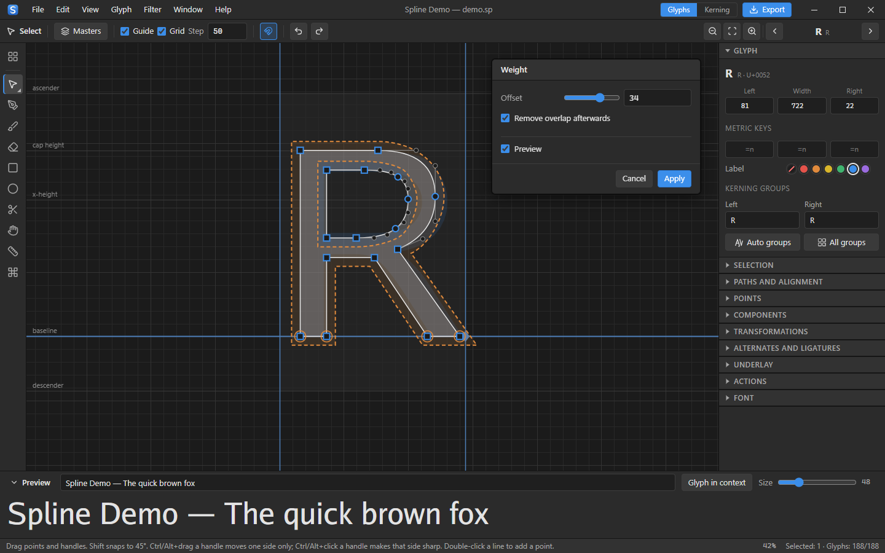
      <br>
      <sub>The Filter menu: every filter has its own window with a preview.</sub>
      <h3>🪄 Filters</h3>
      Weight, rounded corners, stroke, handles · a dashed preview right on the canvas · the windows move and remember their place · Transform Metrics for many glyphs at once.
    </td>
  </tr>
</table>

## Getting started

**Windows (recommended):** download **`Spline-Setup-<version>.exe`** from [Releases](https://github.com/GeekFreak01/spline/releases/latest) and run it. The installer asks where to install and for whom (just you, without administrator rights, or all users), creates shortcuts and associates `.sp` files with Spline. Uninstall it from Settings → Apps.

**Without installing (portable)** or on macOS / Linux:

1. Download the program for your system from [Releases](https://github.com/GeekFreak01/spline/releases):
   - Windows: `spline-windows-amd64.exe`
   - macOS: `spline-macos-arm64` (Apple M1/M2/M3) or `spline-macos-amd64` (Intel)
   - Linux: `spline-linux-amd64`
2. Double-click it. The editor window opens.
   - **Windows 10/11**: the program's own window (WebView2 engine, built into Windows), no browser and no console.
   - **macOS / Linux**: a separate Chrome or Edge window in app mode, without tabs or an address bar.
   - If neither is available, the editor opens in your regular browser.
3. To quit, just close the window.

**In the browser:** [spline.geekfreak.tv](https://spline.geekfreak.tv), nothing to install.

> [!TIP]
> Windows may show "Windows protected your PC": click "More info" → "Run anyway".
> On macOS, the first time: right-click the file → "Open". On Linux/macOS: `chmod +x spline-*`.

### Updates

Spline checks once a day whether a new version is out (and on Help → Check for Updates). If there is one, the status bar shows "Version … available". A click on it opens the latest release on GitHub: download `Spline-Setup-<version>.exe` and run it, it installs over the old version in the same folder. When you already have the latest version, the badge is not shown.

### Icon for `.sp` files (Windows)

Menu **File → Associate .sp Files with Spline**: project files get the Spline icon and the "Spline project" type, and open with a double-click. The change is made only for your Windows user, no administrator rights are needed. If you moved `spline.exe` to another folder, choose the command again.

### Build it yourself

You need [Go](https://go.dev/dl/) 1.22 or newer:

```bash
go run github.com/GeekFreak01/spline@latest
```

or from source:

```bash
git clone https://github.com/GeekFreak01/spline
cd spline
go run .
```

## `.sp` files: share your projects

A project is stored in a **`.sp`** file. It is plain text (JSON), so you can:

- **send it to a friend**: they open it with the Open button or simply drag it into the window;
- **open it with a double-click**: make `spline` the program for `.sp` files
  (or run `spline my-font.sp`), then Save writes straight back to that file;
- **take letters from someone else's project**: "Import Glyphs from .sp" adds them to your font;
- **copy letters**: select glyphs, press `Ctrl+C`, open another project and press `Ctrl+V`.
  You can even send the copied text in a messenger.

Example: [examples/hello.sp](examples/hello.sp). Your work is saved automatically, so an accidentally closed window loses nothing.

<details>
<summary>The .sp file format</summary>

```json
{
  "format": "spline",
  "version": 1,
  "info": { "familyName": "My Font", "styleName": "Regular", "unitsPerEm": 1000,
            "ascender": 800, "descender": -200, "xHeight": 500, "capHeight": 700 },
  "glyphs": [
    { "name": "A", "unicode": 65, "advance": 620, "color": "green",
      "contours": [ { "closed": true, "nodes": [
        { "x": 0, "y": 0 },
        { "x": 300, "y": 700, "in": { "x": 250, "y": 700 }, "out": { "x": 350, "y": 700 }, "smooth": true }
      ] } ] }
  ]
}
```

- Coordinates are in font units (1000 per em), the Y axis points up, the baseline is `y = 0`.
- `nodes` are anchor points; `in`/`out` are absolute positions of the Bézier handles.
  If neighbouring points have no `out`/`in`, the segment between them is a straight line.
- Contour direction does not matter: Spline decides itself what is filled and what is a hole.
- `kernLeft` / `kernRight` of a glyph are its left and right side kerning groups.
  In `kerning`, a key `@name` means a group: `"kerning": { "@A": { "@V": -70 }, "T": { "@o": -80 } }`.
- `compose` marks a letter built from parts (`{ "base": "uni0418", "marks": ["breve"] }`), `composeOff` one drawn by hand;
  `image` is an underlay picture (not exported).
- `contextual` holds alternates: `{ "glyph": "o", "use": "o.alt", "prev": [], "next": ["b", "l"] }`;
  `ligatures` holds ligatures: `{ "glyphs": ["f", "i"], "use": "f_i" }`.
</details>

## Keyboard shortcuts

Shortcuts work with any keyboard layout, including Russian. Any of them can be changed: **Help → Keyboard Shortcuts** (`F1`), click a shortcut and press a new one. In a browser, Ctrl+T, Ctrl+W and Ctrl+N belong to the browser: pick another shortcut or switch to full screen (`F11`).

<details>
<summary>Default shortcuts</summary>

| Key | Action |
|---|---|
| `V` `P` `B` `E` `R` `O` `K` `H` `T` | Select, pen, brush, eraser, rectangle, ellipse, knife, hand, text |
| `Ctrl+R` / `Ctrl+;` | Rulers / show guides |
| `Ctrl+K` | Kerning (`Alt+←/→` ±10, `Alt+Shift+←/→` ±1, `Alt+G` show group, `Ctrl+]` / `Ctrl+[` samples) |
| `Ctrl+T` | Free transform (`Ctrl+Z` inside cancels it) |
| `F1` | Keyboard shortcuts: list and reassign |
| `F9` / `F10` | Snap to grid / to guides |
| `Ctrl+Alt+U` `M` `I` `E` `D` `O` | Unite, subtract, intersect, exclude, divide, remove overlap |
| `Space` (hold) | Pan the canvas |
| `Ctrl+Z` / `Ctrl+Shift+Z` (or `Ctrl+Y`) | Undo / redo |
| Arrows (`Shift` for 10) | Move the selected points |
| `Delete` | Delete points |
| `PageUp` / `PageDown` | Neighbouring glyph |
| `Esc` | Back to all glyphs |
| `Ctrl+S` / `Ctrl+Shift+S` | Save / save as |
| `Ctrl+O` | Open |
</details>

<details>
<summary>Modifiers, like in Illustrator and Figma</summary>

| Key | What it does |
|---|---|
| `Shift` | Straight lines and 45° angles: pen, dragging points and handles, a straight brush stroke, square and circle |
| `Ctrl` / `Alt` + drag a handle | Only this handle moves: one side of the point is curved, the other is not |
| `Ctrl` / `Alt` + click a handle | The handle is removed: this side of the point becomes sharp, the other stays round |
| `Ctrl` / `Alt` + click a point | Sharp corner on both sides |
| Pen: click the last point | A sharp exit from a round point; dragging with `Ctrl`/`Alt` sets only the outgoing handle |
| Double-click a point / a line | Toggle smooth / corner / add a point |
</details>

## How it works

```
spline (a single Go executable)
├── main.go               local server 127.0.0.1:7878
├── window_windows.go     the program window on WebView2 (Windows)
├── window_other.go       a Chrome/Edge app window (macOS, Linux)
├── internal/project      the .sp format: reading and validation
├── internal/fontgen      font building: TrueType (glyf) and OpenType/CFF, GPOS, GSUB
├── internal/ufo          UFO and .designspace: open and save
└── web/                  the interface (HTML/CSS/JS, no build step), embedded with go:embed
    ├── js/trace.js       brush: bitmap → outline → Bézier curve fitting
    ├── js/svg.js         SVG import (paths, shapes, arcs, transforms)
    ├── js/boolean.js     path operations (on Paper.js)
    ├── js/shape.js       letter profiles: groups by shape and kerning suggestions
    └── vendor/           Paper.js, bundled into the program (works offline)
```

- The server listens only on `127.0.0.1` and does not accept requests from other websites.
- No external dependencies at run time, everything works offline.
- The interface design is described in [design-system/spline/MASTER.md](design-system/spline/MASTER.md).

<details>
<summary>Development</summary>

```bash
go run . --dev        # the interface is read from disk, changes show up after a page reload
go test ./...         # font building tests
```

Installer: `installer/spline.iss` (Inno Setup 6), built automatically for every release; locally run `iscc /DAppVersion=1.0.0 installer\spline.iss` after building `dist/spline.exe`.

The icons (`assets/logo.svg`, `assets/file.svg`) are embedded into `spline.exe` with `go generate` (it creates `rsrc_windows_*.syso`).

Flags: `--view "#kern"` / `--view "#glyph=A"` (open a view right away), `--browser` (open in the regular browser), `--port 7878`, `--no-browser` (server only), `--dev`.

Build the Windows version without a console window:

```bash
go build -ldflags "-H=windowsgui" -o spline.exe .
```
</details>

Ideas and fixes are welcome: open an issue or a pull request.

## License

[MIT](LICENSE). Icons: [Lucide](https://lucide.dev) (ISC). Windows window: [go-webview2](https://github.com/jchv/go-webview2) (MIT). Path operations: [Paper.js](http://paperjs.org) (MIT).
