<p align="center">
  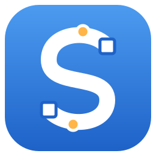
</p>

<h1 align="center">Spline</h1>

<p align="center">
  <b>Облегчённое создание шрифтов.</b><br>
  Рисуйте буквы кистью или пером, импортируйте SVG, расставьте кернинг<br>
  и получите готовый TTF/OTF без долгого изучения программы.
</p>

<p align="center">
  
  
  <a href="https://github.com/GeekFreak01/spline/releases/latest"></a>
  
  
</p>

<p align="center">
  <a href="https://github.com/GeekFreak01/spline/releases/latest"></a>
  &nbsp;
  <a href="https://spline.geekfreak.tv"></a>
</p>

<p align="center">
  <b>Русский</b> · <a href="README.en.md">English</a> ·
  <a href="https://github.com/GeekFreak01/spline/releases">Все релизы</a> ·
  <a href="examples/demo.sp">Демо-проект</a>
</p>

<br>

<p align="center">
  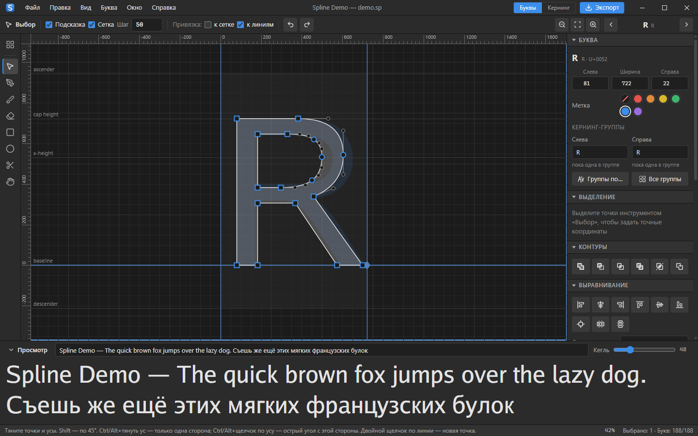
  <br>
  <sub>Редактор контуров: точки, усы, линейки и линии шрифта, панели справа и живой просмотр текста внизу.<br>
  Демо-проект <a href="examples/demo.sp">examples/demo.sp</a> из контуров открытого шрифта Go Regular (© The Go Authors, BSD-подобная лицензия).</sub>
</p>

> [!NOTE]
> **Код проекта почти полностью написан с помощью ИИ.** Идеи взяты из [Glyphs](https://glyphsapp.com) и [FontForge](https://github.com/fontforge/fontforge),
> но всё сделано максимально просто: один файл программы, своё окно без браузера, проекты в одном файле `.sp`.

<p align="center">
  <a href="#возможности">Возможности</a> ·
  <a href="#всё-в-коробке">Всё в коробке</a> ·
  <a href="#как-запустить">Как запустить</a> ·
  <a href="#файлы-sp-делитесь-проектами">Файлы .sp</a> ·
  <a href="#горячие-клавиши">Клавиши</a> ·
  <a href="#как-это-устроено">Как устроено</a>
</p>

<br>

<table>
  <tr>
    <td width="25%" valign="top">
      <h3>🪶 Просто начать</h3>
      Знакомые меню, инструменты и сочетания из Photoshop, Illustrator и Glyphs. Скачали, открыли, рисуете: без настройки и долгого изучения.
    </td>
    <td width="25%" valign="top">
      <h3>✍️ Кисть и пропись</h3>
      Рисуйте мышью или пером: мазок сам становится кривыми. Варианты букв и лигатуры для рукописных шрифтов и соединений.
    </td>
    <td width="25%" valign="top">
      <h3>🔤 Кернинг как в Glyphs</h3>
      Пары и группы, исключения, подбор групп по форме букв и подсказки значений. Видно, кого заденет каждое правило.
    </td>
    <td width="25%" valign="top">
      <h3>📦 Один файл</h3>
      Программа — один исполняемый файл на Go, работает офлайн. Проект — текстовый <code>.sp</code>, его легко отправить в мессенджере.
    </td>
  </tr>
</table>

<br>

## Возможности

<table>
  <tr>
    <td width="50%" valign="top">
      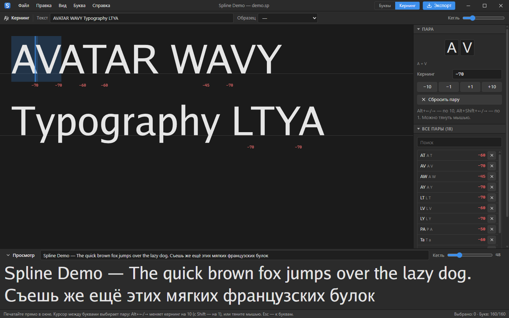
      <br>
      <sub>Строка кернинга: синие полоски — пары сдвинуты ближе, справа выбор «вся группа» или «только эта буква».</sub>
      <h3>Кернинг, который видно</h3>
      Печатайте текст прямо в окне, курсор между буквами выбирает пару. <code>Alt+←/→</code> меняет значение, можно тянуть мышью. Полоски между буквами показывают кернинг: синие — ближе, жёлтые — дальше, красные — слишком тесно.
      <br><br>
      Под каждой буквой пары видно, <b>кого заденет значение</b>: вся группа (с её буквами) или только эта буква. Список всех пар с сортировкой, фильтрами, «Очистить» и «Сжать». В шрифт пишутся <code>GPOS</code> и <code>kern</code>.
    </td>
    <td width="50%" valign="top">
      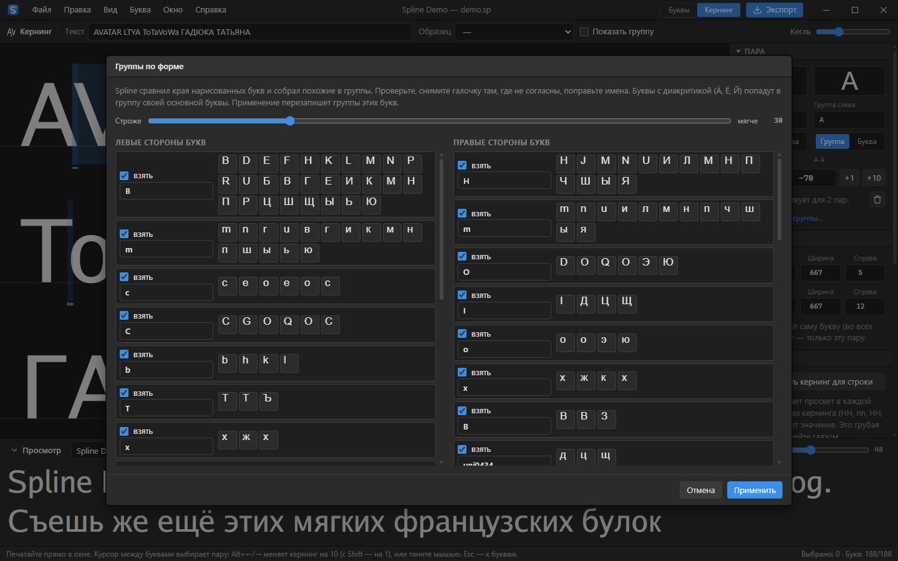
      <br>
      <sub>«Подобрать группы по форме»: Spline сравнил края букв и собрал похожие вместе.</sub>
      <h3>Группы без рутины</h3>
      Кернинг-группы, как в Glyphs: у буквы группа левой и правой стороны, одно правило <code>@A — @V</code> работает для всех. Окно «Кернинг-группы» показывает их карточками, буквы переносятся мышью, группу можно переименовать вместе с её парами.
      <br><br>
      <b>Подобрать по форме</b> сравнивает края нарисованных букв и предлагает группы. <b>Подсказать кернинг</b> предлагает значения для пар строки, а вы принимаете или пропускаете.
    </td>
  </tr>
  <tr>
    <td width="50%" valign="top">
      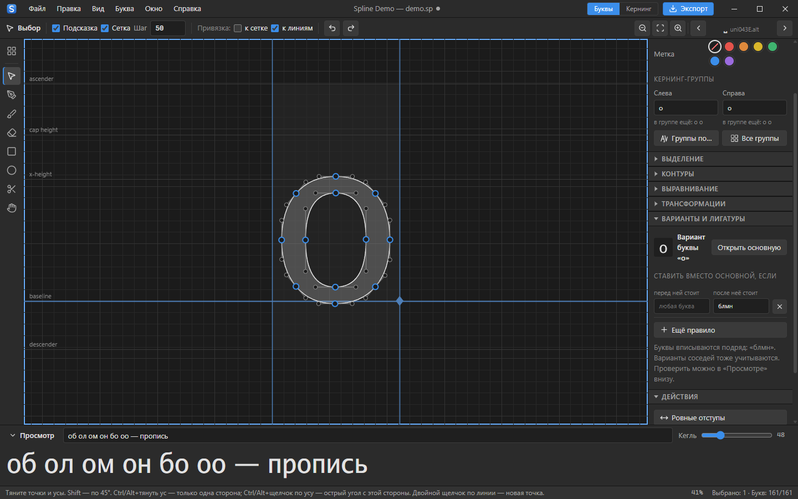
      <br>
      <sub>Вариант «о» для прописи: ставится вместо основной, если после неё «б», «л», «м» или «н».</sub>
      <h3>Варианты и лигатуры для прописи</h3>
      Вариант — другая форма той же буквы, например «о» с другим соединением. Он сам встаёт в текст, если перед ней или после неё стоят нужные буквы. Лигатура заменяет несколько букв подряд одним знаком.
      <br><br>
      В шрифт пишутся стандартные функции OpenType <code>calt</code> и <code>liga</code>: их сразу применяют браузеры, Word, Figma и Photoshop.
    </td>
    <td width="50%" valign="top">
      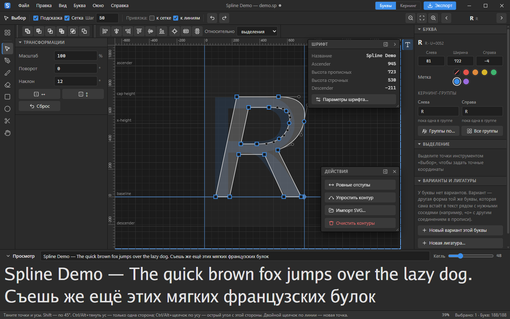
      <br>
      <sub>Панели сверху, слева, иконкой и окном; меню «Окно» открыто.</sub>
      <h3>Рабочее место под себя</h3>
      Как в Photoshop: потяните заголовок панели, и она станет окном. Пристыкуйте её справа, слева, в полосу иконок (щелчок открывает панель) или сверху — туда «Выравнивание» и «Контуры» встают одной строкой.
      <br><br>
      Место для стыковки подсвечивается при перетаскивании, расстановка запоминается. Меню <b>Окно</b> показывает и прячет панели.
    </td>
  </tr>
  <tr>
    <td width="50%" valign="top">
      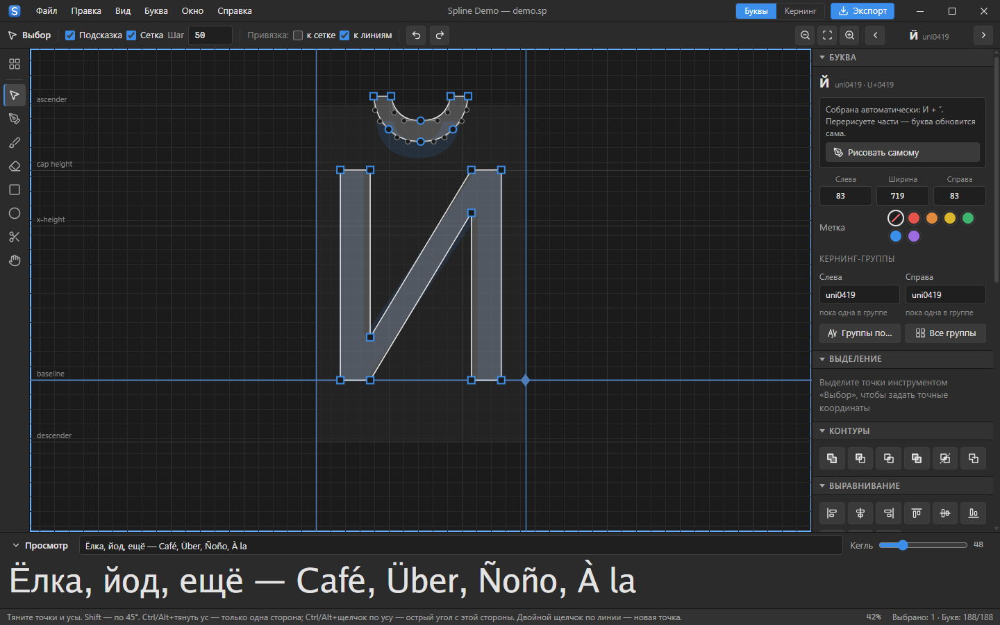
      <br>
      <sub>Й собрана из И и ˘: исправьте И — Й обновится сама.</sub>
      <h3>Буквы с диакритикой собираются сами</h3>
      Нарисуйте основу и знак один раз — Й, Ё, À, é, ñ, ü и другие буквы соберутся из них. Знак встаёт по центру, у прописных поднимается выше и не касается буквы. Перерисовали И или ˘ — все буквы с ними обновились.
      <br><br>
      Нужна своя форма? «Рисовать самому» превращает букву в обычную, а «Собирать автоматически» возвращает обратно.
    </td>
    <td width="50%" valign="top">
      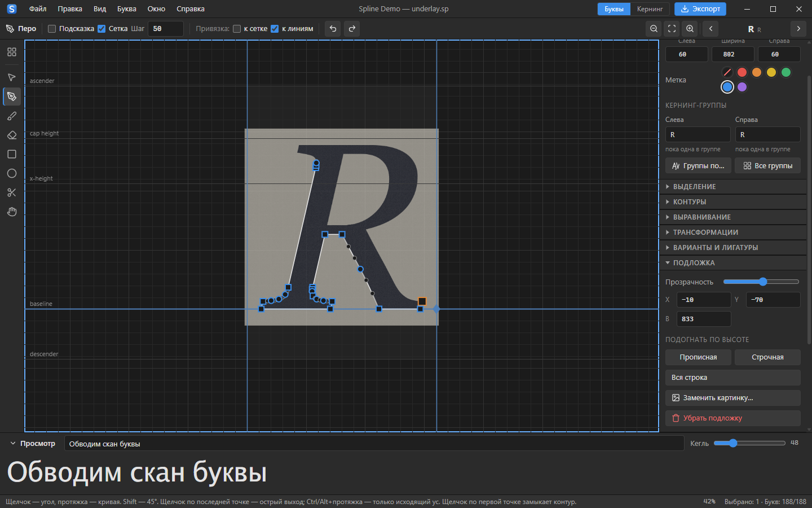
      <br>
      <sub>Скан буквы под контуром и обводка пером.</sub>
      <h3>Подложка из скана или фото</h3>
      Перетащите картинку на холст или на плитку буквы — она встанет по высоте прописной или строчной. Прозрачность, положение и подгонка по линиям шрифта на панели «Подложка». В шрифт картинка не попадает.
      <br><br>
      После кисти или обводки <b>«Упростить контур»</b> уберёт лишние точки, не меняя форму. Готовый <code>.ttf</code>/<code>.otf</code> открывается как проект, а «Установить шрифт в систему» сразу добавляет его в Word и Photoshop.
    </td>
  </tr>
  <tr>
    <td width="50%" valign="top">
      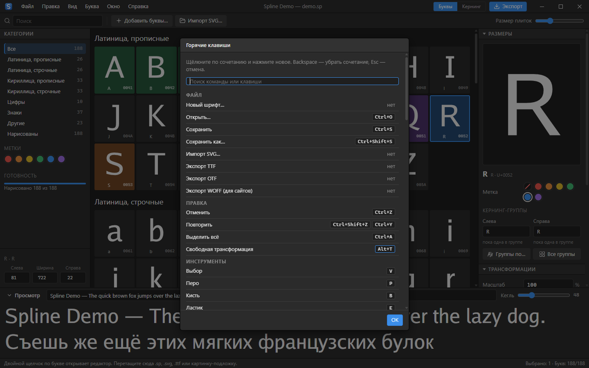
      <br>
      <sub>Горячие клавиши (F1): щёлкните по сочетанию и нажмите новое.</sub>
      <h3>Клавиши, как вам удобно</h3>
      Любое сочетание можно переназначить, в том числе для команд, у которых его не было. Занятое сочетание переедет, а меню и подсказки сразу покажут новые клавиши.
      <br><br>
      Сочетания работают при любой раскладке, в том числе русской. Модификаторы как в Illustrator и Figma: <code>Shift</code> — 45°, <code>Ctrl</code>/<code>Alt</code> — острый угол.
    </td>
    <td width="50%" valign="top">
      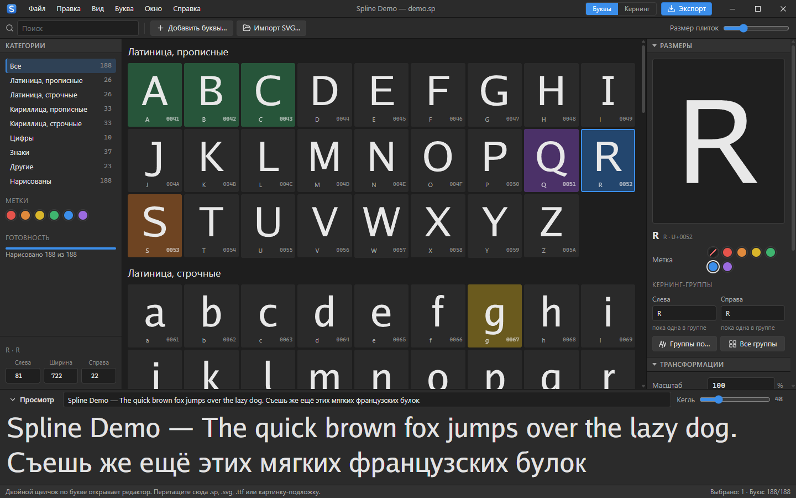
      <br>
      <sub>Все буквы шрифта плитками, с категориями, метками и прогрессом.</sub>
      <h3>Весь шрифт перед глазами</h3>
      Разделы по категориям, цветные метки, коды Unicode, фильтры «нарисованы / не нарисованы». Отступы и группы правятся сразу у выделенных букв.
      <br><br>
      Живой просмотр внизу набирает любой текст вашим шрифтом, недорисованные буквы приглушены. Экспорт в <code>.ttf</code> и <code>.otf</code>.
    </td>
  </tr>
</table>

## Всё в коробке

<table>
  <tr>
    <td width="50%" valign="top">
      <h3>🧰 Рисование</h3>
      Выбор · Перо (кривые Безье) · Кисть со стабилизатором · Ластик · Прямоугольник · Эллипс · Нож · Рука · свободная трансформация <code>Ctrl+T</code> (масштаб, поворот, перемещение, привязка) · операции с контурами (объединить, вычесть, пересечь, исключить, разделить, убрать перекрытия) · выравнивание и распределение относительно выделения, ключевого объекта или рамки буквы · точные координаты точек и фигур · «Упростить контур» убирает лишние точки после кисти · подложка: перетащите скан или фото буквы и обведите его · буквы с диакритикой (Й, Ё, À, é…) собираются сами из основы и знака.
    </td>
    <td width="50%" valign="top">
      <h3>📐 Сетка, линейки, трансформации</h3>
      Сетка с настраиваемым шагом и привязкой (<code>F9</code>) · привязка к линиям шрифта (<code>F10</code>) · линейки и направляющие <code>Ctrl+R</code>, как в Photoshop · трансформации с живыми значениями: масштаб, поворот, наклон от базовой линии, отражение · ровные отступы одной кнопкой.
    </td>
  </tr>
  <tr>
    <td width="50%" valign="top">
      <h3>🔁 Импорт и экспорт</h3>
      SVG из Illustrator, Figma, Inkscape: файлом, перетаскиванием или вставкой кода (<code>Ctrl+V</code>), файлы <code>A.svg</code>, <code>uni0416.svg</code>, <code>Ж.svg</code> сами попадают в свои буквы · буквы из другого <code>.sp</code> · готовый <code>.ttf</code>/<code>.otf</code> открывается как проект · копирование букв между проектами · экспорт <code>.ttf</code> (TrueType) и <code>.otf</code> (CFF) с кернингом, вариантами и лигатурами.
    </td>
    <td width="50%" valign="top">
      <h3>🪄 Удобство</h3>
      Автосохранение · отмена и повтор · своё окно на Windows без браузера · тёмная и светлая темы · русский и английский · иконка и двойной щелчок для файлов <code>.sp</code> · установка шрифта в систему одной кнопкой · имя шрифта по-русски · установщик с выбором папки · уведомление о новой версии · работает и как сайт.
    </td>
  </tr>
</table>

## Расширенный режим

Простой режим остаётся простым. Всё, что нужно для серьёзной работы над шрифтом, включается в **Вид → Расширенный режим** — инструменты появляются в меню, на панелях и в строке инструментов, у каждой кнопки есть подпись и подсказка.

<table>
  <tr>
    <td width="50%" valign="top">
      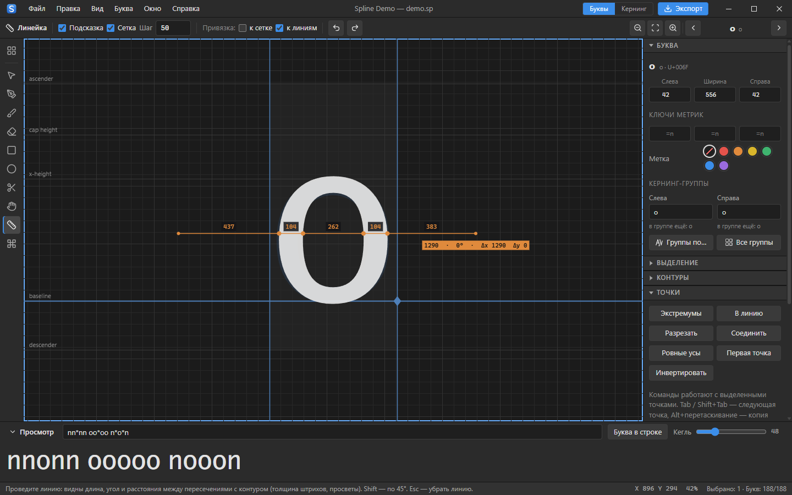
      <br>
      <sub>Линейка меряет толщину штрихов и просветы, панель «Точки» — команды правки.</sub>
      <h3>✏️ Правка и разрядка</h3>
      Экстремумы, «в линию», разрезать и соединить контуры, ровные усы, первая точка, лассо, Tab по точкам, Alt-перетаскивание — копия · инструмент «Линейка»: длина, угол, толщина штрихов · метрические ключи <code>=n</code>, <code>=o+10</code>, <code>=|</code> · отступы прямо в строке кернинга · фон и снимки буквы.
    </td>
    <td width="50%" valign="top">
      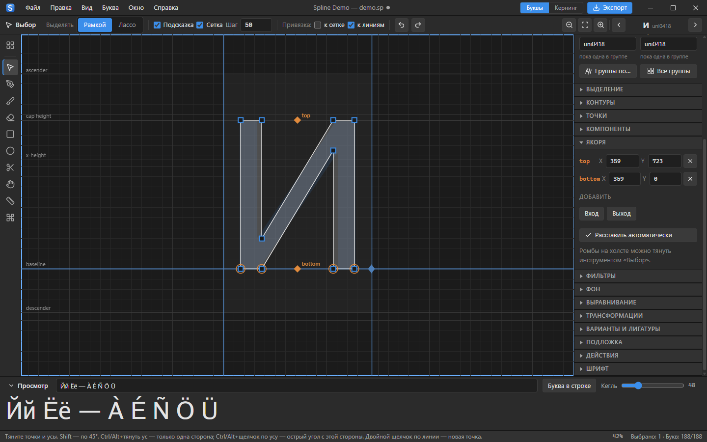
      <br>
      <sub>Якоря «верх» и «низ»: по ним знаки встают на буквы.</sub>
      <h3>🧩 Компоненты и якоря</h3>
      Буква внутри буквы как живая ссылка (À = A + `) · якоря <code>top</code>/<code>_top</code>, вход и выход для прописи · в шрифт пишутся <code>mark</code>, <code>mkmk</code>, <code>curs</code> и GDEF · добавление букв по кодам и целыми алфавитами.
    </td>
  </tr>
  <tr>
    <td width="50%" valign="top">
      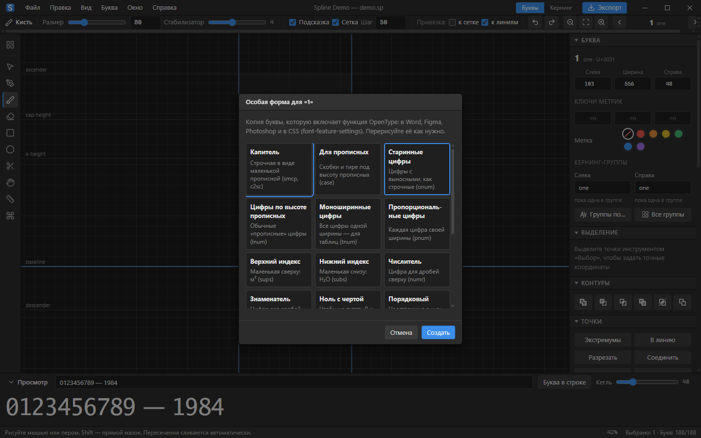
      <br>
      <sub>«Особая форма…»: выберите, для чего копия буквы, — функция OpenType появится сама.</sub>
      <h3>🔠 OpenType без кода</h3>
      «Особая форма…»: капитель, виды цифр, индексы, ноль с чертой, росчерк, стилистические наборы, болгарская и сербская формы · галочки функций в просмотре · свойства шрифта: права, насыщенность, наклон, межстрочный запас · экспорт WOFF.
    </td>
    <td width="50%" valign="top">
      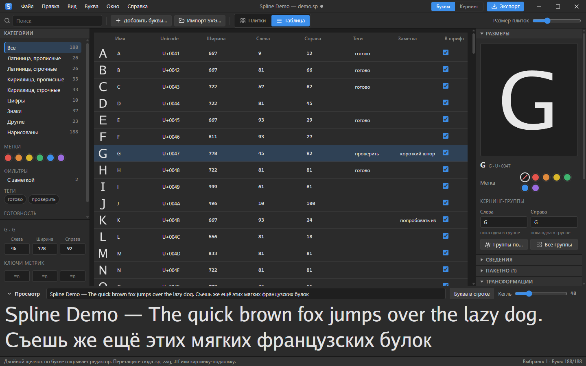
      <br>
      <sub>Таблица: правка в ячейках, теги, заметки и фильтры.</sub>
      <h3>📋 Список букв</h3>
      Таблица с правкой в ячейках и сортировкой · переименование вместе с кернингом и правилами · теги, заметки, «не экспортировать» · фильтры · пакетные команды для выделенных букв · дублирование.
    </td>
  </tr>
</table>

## Как запустить

**Windows (рекомендуется):** скачайте **`Spline-Setup-<версия>.exe`** со страницы [Releases](https://github.com/GeekFreak01/spline/releases/latest) и запустите. Установщик спросит, куда установить и для кого (только для вас, без прав администратора, или для всех пользователей), создаст ярлыки и свяжет файлы `.sp` со Spline. Удаляется программа через «Параметры → Приложения».

**Без установки (portable)** или на macOS / Linux:

1. Скачайте программу для своей системы на странице [Releases](https://github.com/GeekFreak01/spline/releases):
   - Windows: `spline-windows-amd64.exe`
   - macOS: `spline-macos-arm64` (Apple M1/M2/M3) или `spline-macos-amd64` (Intel)
   - Linux: `spline-linux-amd64`
2. Запустите её двойным щелчком. Откроется окно редактора.
   - **Windows 10/11**: собственное окно программы (движок WebView2, уже встроен в Windows), без браузера и без консоли.
   - **macOS / Linux**: отдельное окно Chrome или Edge в режиме приложения, без вкладок и адресной строки.
   - Если ничего из этого нет, редактор откроется в обычном браузере.
3. Чтобы выйти, просто закройте окно.

**В браузере:** [spline.geekfreak.tv](https://spline.geekfreak.tv), ничего устанавливать не нужно.

> [!TIP]
> Windows может показать «Windows защитила ваш компьютер»: «Подробнее» → «Выполнить в любом случае».
> На macOS при первом запуске: правый клик по файлу → «Открыть». На Linux/macOS: `chmod +x spline-*`.

### Обновления

Spline раз в день проверяет, вышла ли новая версия (и по команде «Справка → Проверить обновления»). Если вышла, в строке состояния появится «Доступна версия …». Щелчок по надписи открывает последний релиз на GitHub: скачайте `Spline-Setup-<версия>.exe` и запустите, он установится поверх старой версии в ту же папку. Когда у вас уже последняя версия, надписи нет.

### Иконка для файлов `.sp` (Windows)

Меню **«Файл → Связать файлы .sp со Spline»**: файлы проектов получают иконку Spline, тип «Spline project» и открываются двойным щелчком. Изменение делается только для вашего пользователя Windows, права администратора не нужны. Если переместили `spline.exe` в другую папку, выберите пункт ещё раз.

### Собрать самому

Нужен [Go](https://go.dev/dl/) 1.22 или новее:

```bash
go run github.com/GeekFreak01/spline@latest
```

или из исходников:

```bash
git clone https://github.com/GeekFreak01/spline
cd spline
go run .
```

## Файлы `.sp`: делитесь проектами

Проект хранится в файле **`.sp`**. Это обычный текст (JSON), поэтому его можно:

- **отправить другу**: он откроет файл кнопкой «Открыть» или просто перетащит его в окно;
- **открыть двойным щелчком**: назначьте `spline` программой для файлов `.sp`
  (или запустите `spline мой-шрифт.sp`), тогда «Сохранить» будет записывать прямо в этот файл;
- **взять буквы из чужого проекта**: «Взять буквы из другого файла .sp» добавит их в ваш шрифт;
- **копировать буквы**: выделите буквы, нажмите `Ctrl+C`, откройте другой проект и нажмите `Ctrl+V`.
  Можно даже отправить скопированный текст в мессенджере.

Пример: [examples/hello.sp](examples/hello.sp). Работа автоматически сохраняется, так что случайно закрытое окно ничего не испортит.

<details>
<summary>Формат файла .sp</summary>

```json
{
  "format": "spline",
  "version": 1,
  "info": { "familyName": "Мой шрифт", "styleName": "Regular", "unitsPerEm": 1000,
            "ascender": 800, "descender": -200, "xHeight": 500, "capHeight": 700 },
  "glyphs": [
    { "name": "A", "unicode": 65, "advance": 620, "color": "green",
      "contours": [ { "closed": true, "nodes": [
        { "x": 0, "y": 0 },
        { "x": 300, "y": 700, "in": { "x": 250, "y": 700 }, "out": { "x": 350, "y": 700 }, "smooth": true }
      ] } ] }
  ]
}
```

- Координаты в единицах шрифта (1000 на кегль), ось Y смотрит вверх, базовая линия `y = 0`.
- `nodes` — опорные точки; `in`/`out` — абсолютные координаты «усиков» кривой Безье.
  Если у соседних точек нет `out`/`in`, между ними прямая линия.
- Направление контуров не важно: Spline сам решает, где заливка, а где дырка.
- `kernLeft` / `kernRight` у буквы — её кернинг-группы левой и правой стороны.
  В `kerning` ключ `@имя` означает группу: `"kerning": { "@A": { "@V": -70 }, "T": { "@o": -80 } }`.
- `compose` — буква собрана из частей (`{ "base": "uni0418", "marks": ["breve"] }`), `composeOff` — рисуется вручную;
  `image` — картинка-подложка (в шрифт не попадает).
- `contextual` — варианты: `{ "glyph": "o", "use": "o.alt", "prev": [], "next": ["b", "l"] }`;
  `ligatures` — лигатуры: `{ "glyphs": ["f", "i"], "use": "f_i" }`.
</details>

## Горячие клавиши

Сочетания работают при любой раскладке, в том числе русской. Любое можно поменять: **Справка → Горячие клавиши** (`F1`), щёлкнуть по сочетанию и нажать новое. В браузере Ctrl+T, Ctrl+W и Ctrl+N забирает сам браузер: назначьте другое сочетание или включите полноэкранный режим (`F11`).

<details>
<summary>Сочетания по умолчанию</summary>

| Клавиша | Действие |
|---|---|
| `V` `P` `B` `E` `R` `O` `K` `H` | Выбор, перо, кисть, ластик, прямоугольник, эллипс, нож, рука |
| `Ctrl+R` / `Ctrl+;` | Линейки / показать направляющие |
| `Ctrl+K` | Кернинг (`Alt+←/→` ±10, `Alt+Shift+←/→` ±1, `Alt+G` — показать группу, `Ctrl+]` / `Ctrl+[` — образцы) |
| `Ctrl+T` | Свободная трансформация (`Ctrl+Z` внутри — отменить её) |
| `F1` | Горячие клавиши: список и переназначение |
| `F9` / `F10` | Привязка к сетке / к линиям |
| `Ctrl+Alt+U` `M` `I` `E` `D` `O` | Объединить, вычесть, пересечь, исключить, разделить, убрать перекрытия |
| `Пробел` (зажать) | Двигать холст |
| `Ctrl+Z` / `Ctrl+Shift+Z` (или `Ctrl+Y`) | Отменить / повторить |
| Стрелки (`Shift` — по 10) | Сдвинуть выбранные точки |
| `Delete` | Удалить точки |
| `PageUp` / `PageDown` | Соседняя буква |
| `Esc` | Назад ко всем буквам |
| `Ctrl+S` / `Ctrl+Shift+S` | Сохранить / сохранить как |
| `Ctrl+O` | Открыть |
</details>

<details>
<summary>Модификаторы, как в Illustrator и Figma</summary>

| Клавиша | Что делает |
|---|---|
| `Shift` | Прямые линии и углы, кратные 45°: перо, перетаскивание точек и усов, прямой мазок кистью, квадрат и круг |
| `Ctrl` / `Alt` + тянуть ус | Двигается только этот ус: с одной стороны точки кривая, с другой нет |
| `Ctrl` / `Alt` + щелчок по усу | Ус удаляется: эта сторона точки становится острой, другая остаётся скруглённой |
| `Ctrl` / `Alt` + щелчок по точке | Острый угол с обеих сторон |
| Перо: щелчок по последней точке | Острый выход из скруглённой точки; протяжка с `Ctrl`/`Alt` задаёт только исходящий ус |
| Двойной щелчок по точке / линии | Переключить «гладкая / угловая» / добавить точку |
</details>

## Как это устроено

```
spline (один исполняемый файл на Go)
├── main.go               локальный сервер 127.0.0.1:7878
├── window_windows.go     окно программы на WebView2 (Windows)
├── window_other.go       окно Chrome/Edge в режиме приложения (macOS, Linux)
├── internal/project      формат .sp: чтение и проверка
├── internal/fontgen      сборка шрифта: TrueType (glyf) и OpenType/CFF, GPOS, GSUB
└── web/                  интерфейс (HTML/CSS/JS без сборки), встроен через go:embed
    ├── js/trace.js       кисть: растр → контур → подгонка кривых Безье
    ├── js/svg.js         импорт SVG (пути, фигуры, дуги, трансформации)
    ├── js/boolean.js     операции с контурами (на Paper.js)
    ├── js/shape.js       профили букв: группы по форме и подсказки кернинга
    └── vendor/           Paper.js, встроен в программу (работает офлайн)
```

- Сервер слушает только `127.0.0.1` и не принимает запросы от других сайтов.
- Никаких внешних зависимостей во время работы, всё работает офлайн.
- Дизайн интерфейса описан в [design-system/spline/MASTER.md](design-system/spline/MASTER.md).

<details>
<summary>Разработка</summary>

```bash
go run . --dev        # интерфейс читается с диска, правки видны после обновления страницы
go test ./...         # проверка сборки шрифтов
```

Установщик: `installer/spline.iss` (Inno Setup 6), собирается автоматически при релизе; локально — `iscc /DAppVersion=1.0.0 installer\spline.iss` после сборки `dist/spline.exe`.

Иконки (`assets/logo.svg`, `assets/file.svg`) вшиваются в `spline.exe` командой `go generate` (создаёт `rsrc_windows_*.syso`).

Флаги: `--view "#kern"` / `--view "#glyph=A"` (открыть сразу нужный режим), `--browser` (открыть в обычном браузере), `--port 7878`, `--no-browser` (только сервер), `--dev`.

Собрать Windows-версию без консольного окна:

```bash
go build -ldflags "-H=windowsgui" -o spline.exe .
```
</details>

Идеи и исправления приветствуются: открывайте issue или pull request.

## Лицензия

[MIT](LICENSE). Иконки: [Lucide](https://lucide.dev) (ISC). Окно на Windows: [go-webview2](https://github.com/jchv/go-webview2) (MIT). Операции с контурами: [Paper.js](http://paperjs.org) (MIT).
